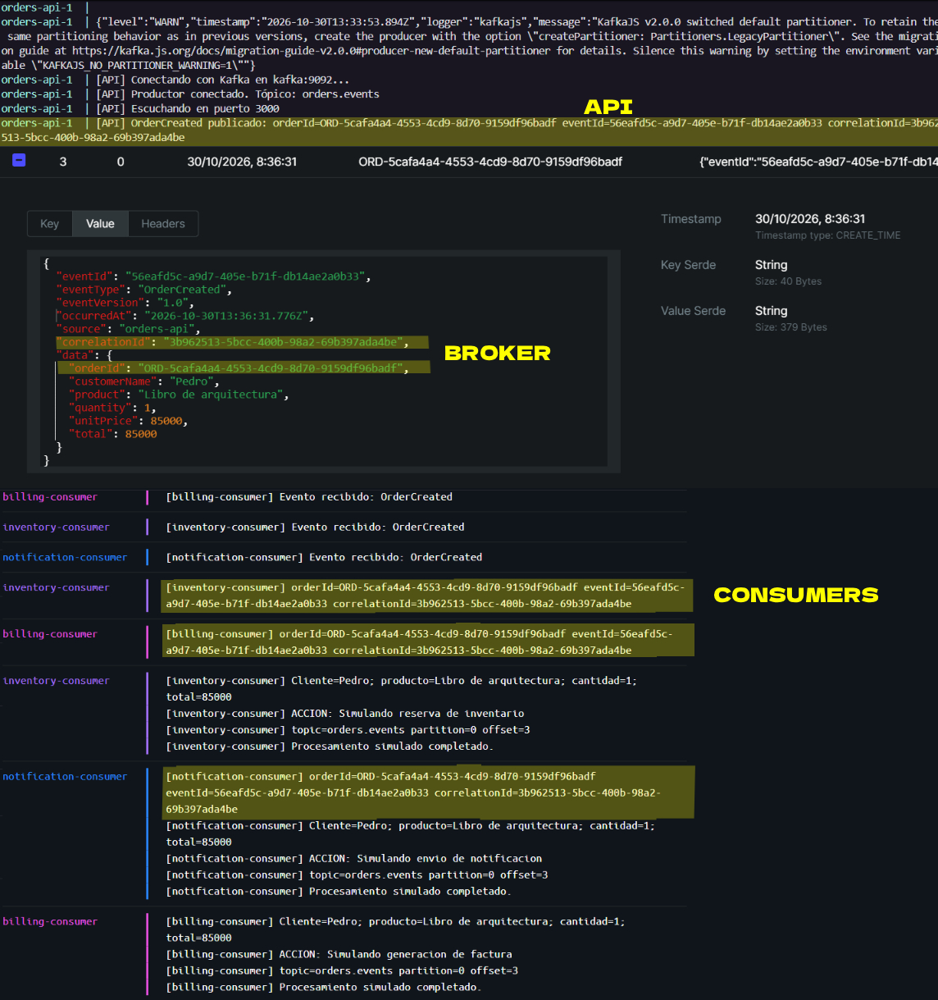
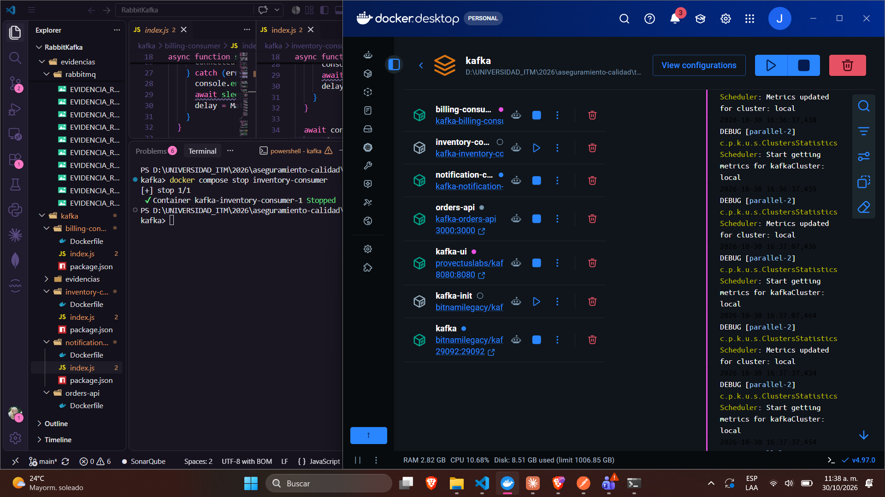

# Informe de casos de prueba exitosos — Kafka

**Proyecto:** Taller 4 – Pruebas de integración en arquitecturas basadas en mensajes y eventos (RabbitMQ y Kafka)
**Fecha de ejecución:** 30/10/2026
**Alcance de este informe:** casos de la sección Kafka con evidencia real y resultado satisfactorio.

## 1. Entorno de prueba

| Elemento | Detalle |
|---|---|
| Orquestación | Docker Compose (kafka, kafka-init, kafka-ui, orders-api, 3 consumidores) |
| Broker | Apache Kafka 3.7 (imagen bitnami), 1 broker, replication-factor 1 |
| Tópico | `orders.events`, 2 particiones (creado por `kafka-init`) |
| Productor | `orders-api` (Node.js 20, Express, KafkaJS) — `POST http://localhost:3000/orders` |
| Consumidores | `inventory-consumer` (`inventory-service-group`), `billing-consumer` (`billing-service-group`), `notification-consumer` (`notification-service-group`) |
| Suscripción | `fromBeginning: true`, un *consumer group* distinto por servicio |
| Herramientas | Postman, PowerShell (`crear-orden.ps1`), Docker Desktop, Kafka UI (puerto 8080) |

Evidencia de infraestructura: [EVIDENCIA_KAFKA_01_Contenedores_Infraestructura.png](../kafka/evidencias/EVIDENCIA_KAFKA_01_Contenedores_Infraestructura.png)

## 2. Resumen de resultados

| ID | Caso de prueba | Estado | Evidencia |
|---|---|---|---|
| CP-01 | Creación de pedido vía API | ✅ Exitoso | `Captura de pantalla 2026-10-30 085555.jpg` |
| CP-04 | Publicación de evento en Kafka | ✅ Exitoso | `CP-ID.jpg` (secciones API y BROKER) |
| CP-05 | Consumo de evento | ✅ Exitoso | `CP-ID.jpg` (sección CONSUMERS) |
| CP-06 | Trazabilidad del flujo | ✅ Exitoso | `CP-ID.jpg` |
| CP-07 | Responsive (respuesta sin esperar al consumidor) | ✅ Exitoso | `Captura de pantalla 2026-10-30 085555.jpg`, `Captura de pantalla .jpg` |
| CP-08 | Message-driven (sin comunicación directa) | ✅ Exitoso | `Captura de pantalla .jpg` |
| CP-09 | Resiliencia ante caída de un consumidor | ✅ Exitoso | `CP-09-01.png`, `CP-09-02.png` |
| CP-11 | Desacoplamiento temporal | ✅ Exitoso | `CP-11-1.png`, `CP-11-2.png` |

**8 de 8 casos con evidencia fueron exitosos.** Los casos CP-10 (elasticidad) y CP-12 (recuperación tras reinicio de broker/consumidor) no tienen evidencia en la carpeta y por tanto no se declaran como exitosos aquí (ver sección 4). CP-02 y CP-03 corresponden a RabbitMQ.

---

## 3. Detalle por caso

### CP-01 — Creación de pedido vía API

- **Descripción:** validar que el endpoint recibe y responde correctamente.
- **Precondición:** contenedores en ejecución, `orders-api` escuchando en el puerto 3000.
- **Entrada:** `POST /orders` con `{"customerName":"Pedro","product":"Libro de arquitectura","quantity":1,"unitPrice":85000}`.
- **Resultado esperado:** respuesta de aceptación con `orderId`.
- **Resultado observado:** `202 Accepted` en 40 ms con `{"status":"accepted","message":"Pedido recibido y evento OrderCreated publicado en Kafka","orderId":"ORD-19dd5b90-cff2-45ed-95c0-4fe4424976aa"}`. El log de `orders-api` registra `OrderCreated publicado` con el mismo `orderId`.
- **Evidencia:** 
- **Estado:** ✅ Exitoso

### CP-04 — Publicación de evento en Kafka

- **Descripción:** verificar que se genera el evento `OrderCreated`.
- **Resultado esperado:** el evento queda almacenado en `orders.events`.
- **Resultado observado:** Kafka UI muestra el mensaje en el tópico (partición 0, offset 3) con clave = `orderId`, `eventType: "OrderCreated"`, `eventVersion: "1.0"`, `source: "orders-api"`, `correlationId` y el bloque `data` (cliente, producto, cantidad 1, precio unitario 85000, total 85000). Timestamp 30/10/2026 8:36:31.
- **Evidencia:** 
- **Estado:** ✅ Exitoso

### CP-05 — Consumo de evento

- **Descripción:** validar que los consumidores reciben el evento.
- **Resultado esperado:** los tres servicios procesan el mismo evento.
- **Resultado observado:** `inventory-consumer`, `billing-consumer` y `notification-consumer` registran `Evento recibido: OrderCreated`, cada uno con su acción simulada (reserva de inventario, generación de factura, envío de notificación) y `topic=orders.events partition=0 offset=3`. Cada servicio usa un grupo distinto, por lo que todos reciben el mismo evento.
- **Evidencia:** sección CONSUMERS de [CP-ID.jpg](CP-ID.jpg)
- **Estado:** ✅ Exitoso

### CP-06 — Trazabilidad del flujo

- **Descripción:** seguir un mismo pedido por API, broker y consumidores.
- **Resultado esperado:** los identificadores coinciden en todos los puntos.
- **Resultado observado:**

| Punto | orderId | eventId | correlationId |
|---|---|---|---|
| API (log) | `ORD-5cafa4a4-4553-4cd9-8d70-9159df96badf` | `56eafd5c-a9d7-405e-b71f-db14ae2a0b33` | `3b962513-5bcc-400b-98a2-69b397ada4be` |
| Broker (Kafka UI) | igual | igual | igual |
| inventory / billing / notification | igual | igual | igual |

- **Evidencia:** 
- **Estado:** ✅ Exitoso

### CP-07 — Responsive

- **Descripción:** la API responde sin esperar al procesamiento de los consumidores.
- **Resultado esperado:** respuesta inmediata `202` independiente del consumo.
- **Resultado observado:** la API responde `202 Accepted` en 40 ms, tras confirmar la publicación en Kafka (`producer.send`), sin invocar a los consumidores. El procesamiento se registra después, de forma independiente, en los logs de cada servicio.
- **Evidencia:** respuesta en [CP-01](Captura%20de%20pantalla%202026-10-30%20085555.jpg) y código del endpoint en [Captura de pantalla .jpg](Captura%20de%20pantalla%20.jpg).
- **Nota:** el tiempo de 40 ms es consistente con la tesis pero, por sí solo, no la demuestra; la prueba más contundente es que `inventory-consumer` estaba detenido (CP-09) y la API siguió respondiendo `202`.
- **Estado:** ✅ Exitoso

### CP-08 — Message-driven

- **Descripción:** no existe comunicación directa entre servicios.
- **Resultado esperado:** los servicios solo se comunican a través de Kafka.
- **Resultado observado:** el productor únicamente ejecuta `producer.send` al tópico `orders.events` (con cabeceras `eventType`, `eventId`, `correlationId`). Cada consumidor se configura en `docker-compose.yml` solo con `KAFKA_BROKER`, `KAFKA_TOPIC` y `KAFKA_GROUP_ID`, y se suscribe con `consumer.subscribe`. No hay URLs ni llamadas HTTP entre servicios.
- **Evidencia:** 
- **Estado:** ✅ Exitoso

### CP-09 — Resiliencia ante caída de un consumidor

- **Descripción:** el sistema soporta la caída de un consumidor.
- **Procedimiento:** `docker compose stop inventory-consumer`; se envían 3 pedidos con `New-Order 3`.
- **Resultado esperado:** la API sigue aceptando pedidos y los demás consumidores siguen procesando.
- **Resultado observado:** el contenedor `inventory-consumer` queda detenido (Docker Desktop lo muestra apagado y el resto activo). Los 3 pedidos devuelven `accepted`. `billing-consumer` y `notification-consumer` procesan los 3 eventos (offsets 1959 y 1960 en partición 1, 2002 en partición 0).
- **Evidencia:**
  
  
- **Estado:** ✅ Exitoso

### CP-11 — Desacoplamiento temporal

- **Descripción:** los eventos publicados con el consumidor apagado se procesan cuando este se inicia.
- **Procedimiento:** con `inventory-consumer` detenido y 3 eventos publicados, `docker compose start inventory-consumer`.
- **Resultado esperado:** el consumidor procesa los eventos pendientes sin pérdida.
- **Resultado observado:** el consumidor se reconecta, se une al grupo `inventory-service-group` (asignación de las particiones `[0,1]`) y procesa los 3 eventos publicados durante su ausencia: `orderId` ORD-da952a8a… (p1/offset 1959), ORD-51521764… (p1/offset 1960) y ORD-569e8887… (p0/offset 2002). Coinciden con los procesados por billing y notification en CP-09.
- **Evidencia:**
  
  
- **Estado:** ✅ Exitoso

---

## 4. Casos sin evidencia (fuera de este informe)

| ID | Caso | Situación |
|---|---|---|
| CP-10 | Elastic (varias instancias del mismo grupo) | Sin capturas en `evidencia-kafka`. Pendiente de ejecutar con `docker compose up -d --scale inventory-consumer=2` y `crear-orden.ps1 -Count 12`. |
| CP-12 | Recuperación tras reinicio del consumidor/broker | Sin capturas. La parte del consumidor queda parcialmente cubierta por CP-11, pero no se documentó como CP-12; el reinicio del broker no se ha probado. |

## 5. Conclusiones

- Los 8 casos ejecutados y documentados fueron **exitosos**: la API acepta el pedido, publica el evento `OrderCreated` en `orders.events` y los tres consumidores lo procesan de forma independiente.
- **Trazabilidad:** `orderId`, `eventId` y `correlationId` se conservan de extremo a extremo.
- **Desacoplamiento y resiliencia:** la caída de `inventory-consumer` no afectó a la API ni a los demás consumidores, y Kafka retuvo los eventos hasta que el consumidor volvió, sin pérdida.
- **Limitaciones:** el broker es único (replication-factor 1) y el sistema usa procesamiento simulado, por lo que las conclusiones aplican al comportamiento de integración, no a tolerancia a fallos del broker ni a carga real.
